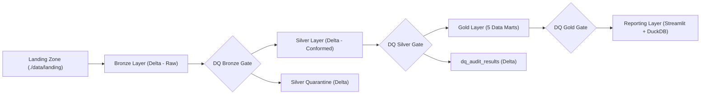

# Lakehouse Architecture Design Document

> **Instructions:** Complete each section below as you design and build your Medallion Lakehouse pipeline. Replace all `<!-- TODO: ... -->` placeholders with your concrete implementation choices, schema conventions, and Spark UI evidence. Refer to [`STUDENT_ASSIGNMENT.md`](./STUDENT_ASSIGNMENT.md) and [`SANITY_CHECKS.md`](./SANITY_CHECKS.md) for requirements.

---

## 1. System & Medallion Architecture Diagram

<!-- TODO: Expand this Mermaid diagram to reflect all 10 Bronze tables, your Silver cleansed & quarantine tables, the 5 Gold marts, DQ gates, Airflow orchestration, and the Streamlit/DuckDB reporting layer. -->



---

## 2. Storage Format & Partitioning Strategy

<!-- TODO: Document your Delta Lake directory structure, partitioning keys, and idempotent write strategy (e.g., overwrite vs. replaceWhere / Delta MERGE / delete+append by _batch_date). -->

| Layer | Path Pattern | Partition Column(s) | Write / Idempotency Strategy |
| :--- | :--- | :--- | :--- |
| **Bronze (Full Load)** | `lakehouse/bronze/<table>` | None | Overwrite snapshot |
| **Bronze (Daily Batch)** | `lakehouse/bronze/<table>` | `_batch_date` | Delta overwrite with `replaceWhere _batch_date = '<date>'` (`common/bronze_io.write_daily`); a missing source file is skipped, never written as an empty frame |
| **Silver** | `lakehouse/silver/<table>` | <!-- TODO --> | <!-- TODO --> |
| **Silver Quarantine** | `lakehouse/silver_quarantine/<table>` | `_batch_date` | Delete `_batch_date` + append |
| **Gold** | `lakehouse/gold/<table>` | <!-- TODO --> | <!-- TODO --> |
| **DQ Audit** | `lakehouse/dq/dq_audit_results` | `batch_date` | Delete `(batch_date, layer, table_name)` + append |

---

## 3. SCD Type 2 Design (`silver_employees_scd2`)

<!-- TODO: Document your SCD Type 2 design in detail:
1. Interval convention: Closed `[valid_from, valid_to]` vs. Half-open `[valid_from, valid_to)` and what sentinel value (e.g. `9999-12-31` or `NULL`) is used for `is_current = true`.
2. Tracked attributes (`department`, `role`, `hourly_rate_eur`, `is_active`, `termination_date`, `churn_type`).
3. How consecutive snapshots without attribute changes are collapsed or skipped.
4. Exact point-in-time join predicate used in `gold_project_profitability` when joining `silver_timesheets` on `work_date`.
-->

Job: `spark_jobs/silver/transform_employees_scd2.py` → `lakehouse/silver/silver_employees_scd2`.

- **Interval Convention:** Half-open `[valid_from, valid_to)`. `valid_to` of a version equals `valid_from` of the next version of the same employee, so intervals are contiguous with no gaps and no overlaps.
- **Open-End Sentinel:** `valid_to = 9999-12-31` and `is_current = true` for the latest version (no `NULL` end dates, so range predicates need no `COALESCE`).
- **Tracked attributes:** `department`, `role`, `hourly_rate_eur`, `is_active`, `termination_date`, `churn_type`. A SHA-256 `record_hash` over these columns (NULL encoded as `<NULL>`) is compared with the previous daily snapshot of the same `emp_id` (`lag` over `snapshot_date`). Profiling of the 200 dev days showed no other attribute (`seniority_level`, `work_mode`, `manager_id`, …) ever changes, so nothing is lost by tracking only these.
- **Collapsing unchanged snapshots:** only snapshots where the hash differs from the previous day start a new version; unchanged days are folded into the open version. `last_seen_date` records the last snapshot that confirmed the version; `version_number` counts versions per employee. 200 days × 1,200 employees (240,000 snapshot rows) collapse to 1,399 versions (max 3 per employee).
- **Effective date:** `snapshot_date` (falls back to `_batch_date`). The first version starts at the employee's first snapshot (2026-01-01), not `hire_date`, because history before the first snapshot is unknown.
- **Load strategy:** the table is rebuilt from all Bronze snapshots with `_batch_date <= batch_date` and overwritten. This is deterministic, so re-running a date gives an identical table, and a backfill in date order reproduces the state as of each day. Run backfills sequentially (`max_active_runs=1`). Data size is small (≈1,200 rows per day), so a full rebuild costs seconds.
- **Hard DQ checks (ERROR):** non-null `emp_id` / `valid_from`, unique `(emp_id, valid_from)`, no overlap or gap between consecutive versions, exactly one `is_current` per employee, every employee in the latest snapshot present.
- **Point-in-Time Join Condition:**
  ```sql
  ts.emp_id = emp.emp_id
  AND ts.work_date >= emp.valid_from
  AND ts.work_date <  emp.valid_to
  ```

---

## 4. Near-Duplicate Tie-Breaker Policy

<!-- TODO: Document your deterministic tie-breaker rule (`Window.partitionBy(id).orderBy(...)`) for resolving exact and near-duplicates in `timesheets` (`ts_id`), `expenses` (`exp_id`), and `employee_surveys` (`survey_id`). Explain why it is deterministic across re-runs. -->

| Dataset | Business Key | Tie-Breaker Ordering Rule | Rationale |
| :--- | :--- | :--- | :--- |
| `timesheets` | `ts_id` | `Window.partitionBy("ts_id").orderBy(hours ASC NULLS LAST, project_id ASC NULLS LAST, _ingested_at DESC)`, keep `row_number = 1`, within one `_batch_date` | Profiling (200 days): duplicates never cross daily files, copies differ only in `hours`, and in all 23,057 near-duplicate groups the original (first row in the file) has the lowest `hours`. The rule is a pure function of row values, so it is identical across re-runs. Dedup runs before quarantine; `_duplicate_count` keeps the number of raw copies. |
| `expenses` | `exp_id` | <!-- TODO --> | <!-- TODO --> |
| `employee_surveys` | `survey_id` | <!-- TODO --> | <!-- TODO --> |

---

## 5. Spark Shuffle Skew Analysis (`crm_events` — `VIP_CORP_001`)

`VIP_CORP_001` accounts for roughly **45%** of all `crm_events` rows, causing severe skew during distributed joins/aggregations against `silver_clients`.

<!-- TODO: Document:
1. Baseline skewed run behavior (what went wrong / long tail task durations).
2. Skew mitigation technique implemented (e.g., Broadcast Join, Spark AQE skew join, or Key Salting — explain why and include Spark configs/salting factor).
3. Before vs. After metrics from the Spark UI / Spark History Server (`http://localhost:18080`).
4. Embed or link Spark UI screenshots saved under `docs/images/` (do not commit huge binaries if avoidable; keep compressed PNGs small).
-->

### Before vs. After Skew Mitigation Metrics

| Metric | Unoptimized (Skewed Shuffle Join) | Optimized (Your Strategy) |
| :--- | :---: | :---: |
| **Strategy / Config** | Sort-Merge Join (default) | <!-- TODO --> |
| **Stage Duration** | <!-- TODO --> | <!-- TODO --> |
| **Max Task Duration vs. Median** | <!-- TODO --> | <!-- TODO --> |
| **Max Shuffle Read Size per Task** | <!-- TODO --> | <!-- TODO --> |
| **Spill (Memory / Disk)** | <!-- TODO --> | <!-- TODO --> |

### Spark UI Screenshots

<!-- TODO: Add screenshots showing stage task summary / event timeline before and after optimization. -->
- **Baseline (Skewed):** `<!-- TODO: add screenshot link -->`
- **Optimized:** `<!-- TODO: add screenshot link -->`

---

## 6. Data Quality & Quarantine Architecture

<!-- TODO: List all Hard (`severity = ERROR`) and Soft (`severity = WARN`) checks implemented across Bronze, Silver, and Gold, along with quarantine routing rules and threshold justifications. -->

| Layer | Table | Check Name | Severity | Rule / Threshold | Action on Failure |
| :--- | :--- | :--- | :---: | :--- | :--- |
| Silver | `silver_clients` | `not_null_client_id` | `ERROR` | `client_id IS NOT NULL` (Reference sample) | Fail task |
| Silver | `silver_employees_scd2` | `not_null_emp_id`, `not_null_valid_from` | `ERROR` | Keys are never NULL | Fail task |
| Silver | `silver_employees_scd2` | `unique_emp_id_valid_from` | `ERROR` | `(emp_id, valid_from)` unique | Fail task |
| Silver | `silver_employees_scd2` | `scd2_no_overlap_no_gap` | `ERROR` | `valid_from < valid_to` and `valid_to` = next `valid_from` | Fail task |
| Silver | `silver_employees_scd2` | `scd2_one_current_per_emp` | `ERROR` | Exactly one `is_current = true` per `emp_id` | Fail task |
| Silver | `silver_employees_scd2` | `scd2_covers_latest_snapshot` | `ERROR` | Every `emp_id` of the latest Bronze snapshot has a version | Fail task |
| Silver | `silver_timesheets` | `not_null_ts_id`, `unique_ts_id` | `ERROR` | Valid rows have a unique, non-NULL `ts_id` | Fail task |
| Silver | `silver_timesheets` | `row_reconciliation` | `ERROR` | valid + quarantined = distinct `ts_id` in Bronze for the batch (no silent loss) | Fail task |
| Silver | `silver_timesheets` | `quarantine_ratio` | `WARN` | Quarantined / (valid + quarantined) > 8% | Log, continue |
| Silver | `silver_timesheets` | `duplicate_rate` | `WARN` | Duplicate rows removed / Bronze rows > 10% | Log, continue |
| Silver | `silver_timesheets` | `quarantine_<reason>` (7 checks) | `WARN` | Count per reason > 0: `missing_ts_id`, `missing_project_id`, `missing_hours`, `hours_non_positive`, `hours_over_24`, `unknown_employee`, `work_after_termination` (zombie timesheets, point-in-time against SCD2) | Row to `silver_quarantine/timesheets` with `dq_reasons`, continue |
| <!-- TODO --> | <!-- TODO --> | <!-- TODO --> | <!-- TODO --> | <!-- TODO --> | <!-- TODO --> |

---

## 7. Orchestration & Reporting Layer Design

<!-- TODO: Summarize your Airflow DAG schedule, task dependencies, retry/timeout policies, Gold mart refresh pattern, and how DuckDB reads Delta tables in Streamlit. -->
